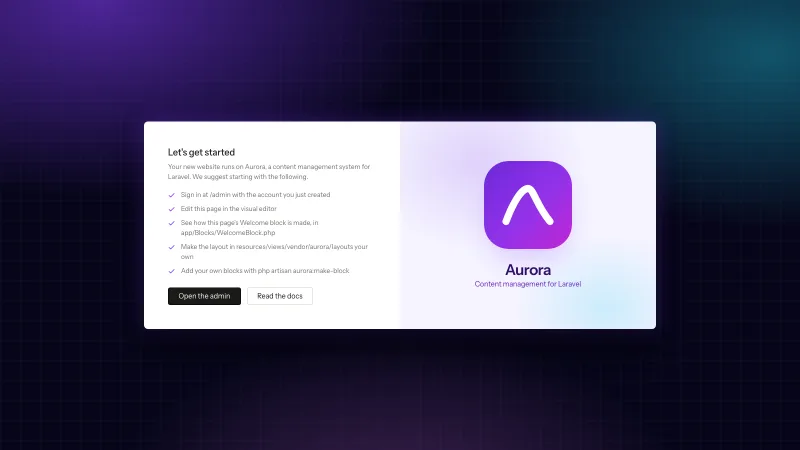

# Aurora

**The starter app for a new website on [Aurora](https://shipaurora.com)**, a content management
system for Laravel, built on Filament. It's a Laravel application with the CMS already installed,
ready to make your own: editors build pages in a visual editor on the real design, and the website
stays plain Laravel code.



## Requirements

- PHP 8.3 or newer, with the GD or Imagick extension
- Composer 2 and Node.js 20 or newer
- A database: SQLite, MySQL/MariaDB or PostgreSQL

## Create a site

```bash
composer create-project shipaurora/aurora my-site && cd my-site
php artisan aurora:install
npm install && npm run build
```

`aurora:install` sets up the database and what the CMS needs, and creates your admin account. Say
yes when it offers to run the website's own seeders: that publishes the first homepage. Then open
the site (with [Laravel Herd](https://herd.laravel.com), `http://my-site.test`; otherwise
`php artisan serve`) and sign in at `/admin`.

## What's in it

| Where | What |
| --- | --- |
| `app/Blocks/WelcomeBlock.php` | The homepage's block: an example of a block of the website's own, its fields and its picture in the editor |
| `resources/views/components/blocks/welcome.blade.php` | The block's view, the same on the website and in the editor |
| `resources/views/vendor/aurora/layouts` | The page layouts (standard, landing page, minimal and blank), published to make your own |
| `resources/css/app.css` | The website's stylesheet, which the visual editor shows on its canvas too |
| `database/seeders/HomepageSeeder.php` | The first homepage, in English and Norwegian |
| `resources/lang/nb.json` | Norwegian labels for the website's own block |
| `config/aurora.php` | Aurora's settings |

## Next steps

- Edit the homepage in the visual editor, or replace it with blocks of your own.
- Add a block with `php artisan aurora:make-block "Pricing table"`.
- Make the layouts in `resources/views/vendor/aurora/layouts` look like your website.
- Add people with `php artisan make:aurora-user`, choosing each one's role.

## Documentation

Everything else (the visual editor, blocks, layouts, users and roles, languages, AI assistants,
the APIs and configuration) is in the documentation at
[shipaurora.com/docs](https://shipaurora.com/docs).

## License

Aurora is open-source software licensed under the MIT license.
